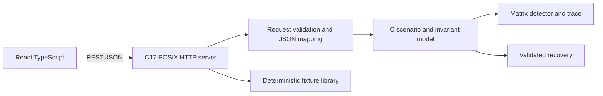

# Deadlock Detection and Recovery Simulator — DeadlockLab

**Team 12 · Operating Systems**  
K. Shiva Reddy (2520030105) · Dakur Manoj Kumar (2520030040)

**Observe. Explain. Recover.**

Deadlocks are difficult to understand because processes can hold resources while waiting for other resources. A static diagram can show a circular dependency, but it does not demonstrate how the system reaches that state, why a detector identifies it, or how recovery changes the outcome.

DeadlockLab is an interactive operating-systems laboratory for constructing or loading resource-allocation scenarios, running deadlock detection, inspecting the algorithm’s reasoning, applying supported recovery strategies, and verifying the resulting state. It is built for student exploration and instructor demonstrations: users can change allocations and requests, then observe how those changes affect detection and recovery.

The engine is implemented in C17, with a POSIX HTTP API and a React/TypeScript interface. The C engine validates resource state, runs matrix-based deadlock detection and Banker’s safety analysis, and applies supported recovery transitions. The frontend visualizes the canonical scenario state and the API’s trace.

## Problem and objectives

The application makes deadlock analysis an explainable investigation workflow: observe the resource-allocation graph, understand the algorithm’s reasoning, choose a recovery strategy, and verify the outcome. The interface is organized around this reasoning process rather than only displaying a final result.

## Features

- C17 domain model and standalone matrix detector, independent of HTTP and UI code.
- POSIX HTTP/1.1 API with deterministic fixtures and stateless detection requests. It binds to `127.0.0.1` only; non-loopback `BIND_ADDRESS` values are refused.
- Bounded JSON parsing with complete syntax validation, duplicate-key rejection, typed fields, exact scenario keys, and bounded request sizes.
- Work/Request component trace, deterministic evaluation order, validation and resource-accounting invariants.
- Separate C Banker’s safety module and `/api/safe-state` endpoint using Max and derived Need; unsafe is explicitly not called deadlock.
- Process termination, checkpoint restore, and checkpoint-backed rollback of configured preemptible resources.
- React + TypeScript light-theme UI with scenario editing, SVG graph, trace controls, fixture library, event list, JSON export, guide, and responsive layouts.
- Scroll reveals, animated graph edges and nodes, animated trace steps, subtle hover responses, a scroll progress cue, and reduced-motion support.
- GitHub Actions builds/tests the C server on Ubuntu and checks/tests/builds the frontend.

## Limitations

The C HTTP server handles requests sequentially and is intended for a local demo. It accepts bounded HTTP/1.1 requests with a three-second socket inactivity timeout and an overall bounded header/body read; clients must provide `Content-Length` and JSON content type for POST. Transfer-Encoding is rejected. CORS only controls browser access and is not authentication. Scenarios, checkpoints, and event history are session-scoped; there is no database. Checkpoints are immutable browser-session snapshots sent with recovery requests. Termination, checkpoint restore, and checkpoint-backed victim rollback are implemented; the simulator does not restore instruction-level process state. Scenario import/export uses a strict version 1 envelope. Event history stores bounded before/after snapshots and detection results with read-only replay and strict version 1 replay import. Seeded experiment generation is not implemented. Banker’s safety analysis has a frontend Max-claim editor. The graph is SVG-derived from state, without graph-editor drag/pan controls. Recovery-cost values are illustrative and do not represent measured OS behavior.

## Future scope

Future work may add seeded experiment suites, reproducible recovery-policy comparisons, and richer teaching exercises. Optional real-system telemetry would be a separate capability; the current simulator does not monitor or recover actual operating-system processes.

## Architecture



The algorithm core is portable C. The network server targets POSIX/Linux and handles one request at a time for this classroom demo. It uses no database or third-party C runtime dependency; the JSON parser is a small in-tree implementation. The listener is loopback-only by default and currently refuses non-loopback binding.

More detail: [architecture](docs/architecture.md), [algorithms](docs/algorithms.md), [API contract](docs/api-contract.md), [test plan](docs/test-plan.md), [demo script](docs/demo-script.md).

## Prerequisites

- Ubuntu 22.04+ or another Linux distribution with POSIX sockets.
- GCC or Clang with C17 support, GNU Make.
- Node.js 20+ and npm for the web client.

The current Windows environment has MinGW GCC for testing the portable C core, but WSL reports `E_ACCESSDENIED`; the POSIX API server must be run in Linux/WSL. The C API is not a Java/Spring application.

## Run on Ubuntu / WSL

From the repository root, terminal 1:

```bash
cd backend-c
make test
make
./build/deadlocklab-server
```

Terminal 2:

```bash
cd frontend
npm ci
npm run dev
```

Open `http://localhost:5173`. The API defaults to `http://localhost:8080/api`; set `VITE_API_URL` in a local `.env` file to override it. Set `PORT` to change the C server port. `BIND_ADDRESS` may be omitted or set to `127.0.0.1`/`localhost`; other values are refused.

## Checks and production build

```bash
cd backend-c
make clean test all
cd ../frontend
npm ci
npm run lint
npm test -- --reporter=dot
npm run build
```

Fixture expectations: `no-deadlock` → no unfinished processes; `two-process-deadlock` → P1 and P2; `multi-instance` → no unfinished processes; `zero-allocation` → P2 remains unfinished. Terminating P1 in the two-process fixture returns R1 and allows P2 to finish.

## API examples

```bash
curl http://localhost:8080/api/health
curl http://localhost:8080/api/scenarios
curl http://localhost:8080/api/scenarios/two-process-deadlock
curl -X POST http://localhost:8080/api/detect \
  -H 'Content-Type: application/json' \
  --data-binary @scenario.json
```

See [the API contract](docs/api-contract.md) for payloads and errors.

## Troubleshooting

- **`make` or `gcc` missing:** install build tools with `sudo apt update && sudo apt install build-essential`.
- **Windows reports POSIX header errors:** use a Linux distribution or WSL for the HTTP server. The standalone C core tests compile with MinGW GCC.
- **Frontend reports backend offline:** start `backend-c/build/deadlocklab-server` and check `/api/health`.
- **Port 8080 is occupied:** run `PORT=8081 ./build/deadlocklab-server` and set `VITE_API_URL=http://localhost:8081/api`.

## Attribution and license

Original student project implementation; no external code/assets are intentionally reused. Dependencies retain their respective licenses. Project license: [MIT](LICENSE).
