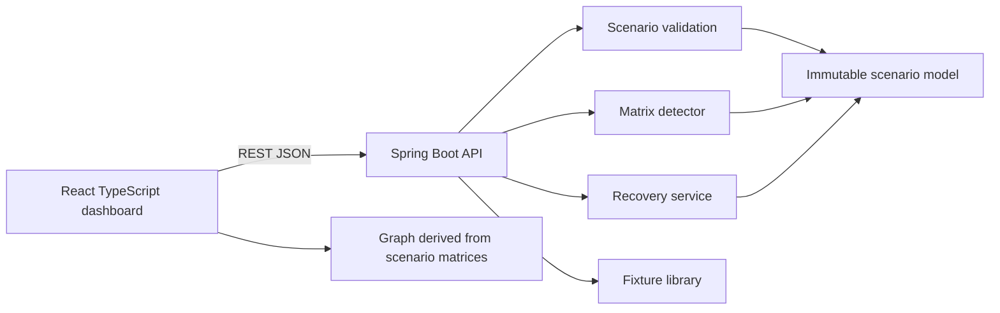

# Deadlock Detection and Recovery Simulator — DeadlockLab

**Team 12 · Operating Systems**  
K. Shiva Reddy (2520030105) · Dakur Manoj Kumar (2520030040)

DeadlockLab is an interactive OS laboratory for constructing resource allocation states, running the multiple-instance detection algorithm, following its Work/Request trace, and simulating process termination recovery.

## Problem and objectives

Deadlock is difficult to reason about from a static allocation table. This project makes the state and every detection decision visible. Students can switch deterministic fixtures, edit allocation/request entries, inspect the derived resource-allocation graph, replay a trace, and terminate a selected process to observe resource release and rerun detection.

## Features

- Spring Boot REST API with stateless detection and explicit scenario payloads.
- Matrix detector implements Work = Available, zero-allocation Finish initialization, deterministic process order, component comparisons, and simulated release.
- Single-instance wait-for graph cycle helper. A graph cycle is not represented as proof of deadlock for multiple instances.
- Invariant validation for dimensions, nonnegative counts, unique IDs, and resource totals.
- Termination recovery that clears the victim allocation, releases instances, validates state, and reruns detection.
- React + TypeScript responsive dashboard, live API-backed fixtures, editable matrices, graph derived from canonical state, trace navigation, event list, and JSON export.
- Learning guide explains Coffman conditions, RAG assumptions, detection and avoidance.

## Limitations

The API has in-memory deterministic fixtures and no persistence. Terminated processes remain in the scenario as historical rows with zero allocations. The UI currently exposes termination recovery; preemption and checkpoint rollback are implemented in the domain service but not yet exposed as UI actions. Cost fields are illustrative only; Banker’s safety checking, seeded experiments, import, and full replay are not implemented. Resource instances are counts rather than individually identified objects. The graph is a custom SVG view with pan/zoom not currently implemented.

## Architecture



Details: [docs/architecture.md](docs/architecture.md), [docs/algorithms.md](docs/algorithms.md), [docs/api-contract.md](docs/api-contract.md), [docs/test-plan.md](docs/test-plan.md), [docs/demo-script.md](docs/demo-script.md).

## Prerequisites

- Java 17 or newer (CI targets 21).
- Maven 3.9+ (Maven is not bundled in this checkout).
- Node.js 20+ and npm.

## Run on Windows PowerShell

Terminal 1, backend:

```powershell
cd .\backend
mvn spring-boot:run
```

Terminal 2, frontend:

```powershell
cd .\frontend
npm.cmd ci
npm.cmd run dev
```

Open the Vite URL (normally `http://localhost:5173`). API defaults to `http://localhost:8080/api`; set `VITE_API_URL` in a local `.env` to change it.

## Tests and production build

```powershell
cd .\backend
mvn test
cd ..\frontend
npm.cmd ci
npm.cmd test
npm.cmd run lint
npm.cmd run build
```

Expected fixture results: `no-deadlock` → no unfinished processes; `two-process-deadlock` → P1 and P2; `multi-instance` → no unfinished processes because P3 completes and releases an instance. Terminating P1 in the two-process fixture releases R1 and allows P2 to complete.

## API quick examples

```powershell
Invoke-RestMethod http://localhost:8080/api/health
Invoke-RestMethod http://localhost:8080/api/scenarios
$scenario = Invoke-RestMethod http://localhost:8080/api/scenarios/two-process-deadlock
Invoke-RestMethod -Method Post -Uri http://localhost:8080/api/detect -ContentType 'application/json' -Body ($scenario | ConvertTo-Json -Depth 20)
```

Full payload shapes and responses are in [the API contract](docs/api-contract.md).

## Troubleshooting

- **Frontend reports backend unavailable:** start the backend first and check `/api/health`.
- **PowerShell says npm.ps1 is blocked:** invoke `npm.cmd` as shown above.
- **mvn is not recognized:** install Maven 3.9+ and ensure `mvn` is on PATH. This repository currently has no Maven wrapper.
- **Port occupied:** configure Spring `server.port` or Vite’s port, and update `VITE_API_URL` if needed.

## Attribution and license

Original student project code; no third-party assets or source code are intentionally reused. Dependencies retain their respective licenses. Project license: MIT (see [LICENSE](LICENSE)).
