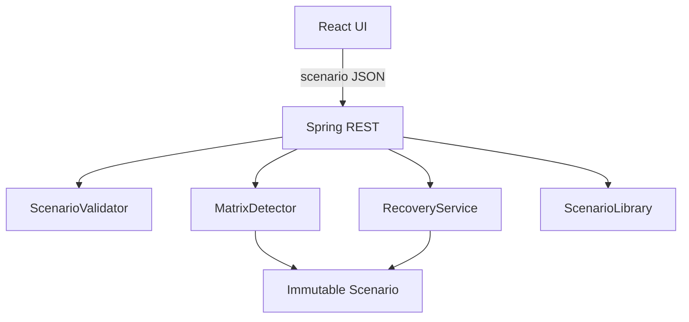

# Architecture

The frontend has one canonical Scenario object. Matrix inputs update that object; the SVG graph is derived from allocations and requests. Detection and recovery requests send the complete current snapshot to the backend. No mutable server-side session or database exists.

Backend packages separate `domain` validation and scenario records, `detection` algorithms and immutable traces, `recovery` state transitions, `scenario` deterministic fixtures, and `api` HTTP endpoints/error handling. The controller owns service instances without mutable state.

Development CORS permits `http://localhost:5173` only. The browser API base defaults to `http://localhost:8080/api` and can be changed with `VITE_API_URL`.
