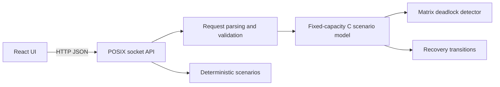

# Architecture

The Linux API and algorithm core are C17. `backend-c/include/deadlocklab.h` defines the fixed-capacity domain model and independent detection/recovery API. `deadlocklab.c` validates invariants, runs the matrix detector, and applies recovery transitions. `server.c` maps HTTP/JSON to the domain. The React client keeps a single canonical scenario object and derives the SVG graph from its matrices.

Build with GNU Make on Linux. No database or third-party C runtime library is used. The API server is single-threaded and intended for a local classroom demo. The algorithm module has no UI, HTTP, or OS-specific dependencies.
